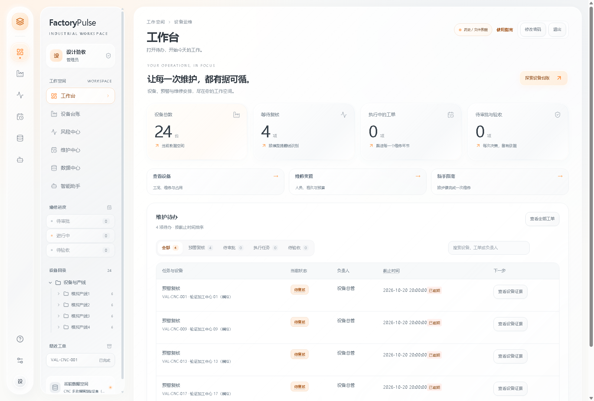

# FactoryPulse

**面向制造企业设备主管与维修团队的 AI 维护决策与业务协同应用。**

设备出现异常后，真正需要解决的是：**先查哪台、为什么要查、什么时候能修、由谁来修、修完如何验收。** FactoryPulse 将监测数据、风险证据、生产占用、维修资源和工单协作连接起来，辅助主管核对条件、形成维护建议，并通过人工审批与工单流程继续处理。

[在线入口](https://factorypulse.griffonage2077.workers.dev) · [使用流程](#如何使用从数据到维修闭环) · [本地启动](#本地启动) · [部署说明](docs/CLOUD-DEPLOYMENT.md)



> 当前定位为工程验证与业务流程演练应用。软件验收采用冻结的合成机床数据，近期多 Agent 情景使用独立模拟输入；两者均不是真实工厂实测收益。**截至 2026-11-03，部署账号的 Cloudflare 数据服务额度已用尽（用户反馈），线上入口、登录和最新业务读取可能受影响；当前可用性未重新联网核实。** 详见[数据服务额度与访问限制](#数据服务额度与访问限制)。

## 最新进展

以下根据截至 **2026-11-03** 保存的运行记录及本地验收整理；本次文档更新没有访问云端或重新运行模型。

| 进展 | 对使用者的意义 | 当前状态 |
| --- | --- | --- |
| 多 Agent 维护建议 | 保留 Plan、Router、Research、Analysis、Review、Report 六角色及现有工具和审批节点；正常任务由模型处理本轮证据 | #17 已发布，固定回放与预置答案捷径已移除；后续缺项修复草稿未发布 |
| 三设备模拟任务 | 核对风险、人员、班次、生产占用、备件与既有占用，返回安排和解释 | 同输入、同六角色配置三轮完整返回：86.079 / 85.818 / 63.115 秒；这是模拟原安排，不是实时查库或自动建单 |
| 缺项处理 | 缺少维护工时则说明无法计算，不把已知小计冒充完整合计 | SIM-C.hours 缺项修复草稿定向通过，94.549 秒；不能与 #17 混算版本表现 |
| 服务失败处理 | 空结果、模型繁忙及连接中断明确提示未完成，避免自动重复提交 | Worker 服务修复已部署；正式 Dify Web 入口此前两次同题均因 503 失败，线上稳定性未证明 |
| 本地工程验证 | 导入恢复、资源冲突、工单流转、权限和缓存隔离按所列用例核对 | 本轮 Python 定向测试 79 项通过、1 项跳过；前端完整构建及所列客户端回归通过；新构建未部署 |

历史发布已包含 D1 V2、手动更新、分层缓存及加密权限票据。当前实际问答与模拟计算已有运行证据；Dify 线上真实只读权限、云端缓存命中、三方案服务接入和部署环境完整工单写入仍缺完整验收。完整范围见[本地验证报告](docs/LOCAL-ACCEPTANCE-2026-11-03.md)、[项目交接](docs/PROJECT-HANDOFF-2026-11-03.md)与 [Dify 接入说明](docs/DIFY-WORKFLOW.md)。

## 数据服务额度与访问限制

**当前已知问题：部署账号的 Cloudflare 数据服务额度用尽。** 此状态依据用户于 2026-11-03 的反馈；尚未取得控制台证据确认具体额度类别、剩余量或恢复时间，不推定是模型额度耗尽，也不承诺某个时间恢复。

- 主站登录、读取最新 D1 数据及正式业务操作依赖云端，额度限制可能影响评审访问；静态页面能打开不代表这些能力正常。
- 已保存在浏览器的业务快照可能仍可显示，但不证明是最新数据；缓存不提供离线登录，读取失败不能解释成“没有冲突”或“操作已完成”。
- 本地正常启动也依赖云端账号与 D1，不能绕过额度问题。通过的本地测试使用隔离临时数据和模拟服务，不是离线生产运行模式。
- Dify 模型服务的 503/50508 繁忙失败与 Cloudflare 额度问题分别记录，不能仅凭额度反馈推定所有失败原因相同。

额度恢复后，提交前仍需核对评审链接、登录账号、最新数据读取和一次完整模型返回。本次未进行该线上核对，在线入口当前不保证可用。

## 谁会使用它

| 目标用户 | 日常问题 | 在 FactoryPulse 中完成什么 |
| --- | --- | --- |
| **设备主管、设备管理人员**（核心用户） | 异常很多，先处理哪个？维修会不会影响生产？ | 复核设备证据、创建维护需求、比较安排、审批与验收 |
| **维修班组与维修人员** | 今天修什么？何时开工？结果交给谁？ | 查看个人工单、接单、开工、暂停与恢复、提交维修结果 |
| **部署与系统维护人员** | 如何配置账号、数据与计算服务？ | 管理权限、接入数据、配置 AI 与服务、检查运行记录 |
| **只读查看人员** | 如何了解设备和维修进展？ | 查询设备状态、风险证据、工单进度和维修履历 |

适合需要把**设备监测与维修协作接起来**的制造业维护场景，也可用于预测性维护与约束排程的工程演练。使用企业数据时，需要先核对字段、时间、单位及实际维修资源。

## 核心思路与创新点

### 1. 风险证据直接进入维护决策

从设备风险页可以继续复核、转为维护需求、生成安排，直到审批、维修和验收。设备、数据版本、需求、方案及处理记录相互关联，便于追查一次维修为什么发生、依据是什么、最终如何处理。

### 2. 排程同时考虑“该修”与“能修”

维护优先级需要与人员技能、班次、设备停机窗口、生产订单占用、备件、预算和工时一起考虑。系统列出缺项与冲突，帮助主管判断需要补资源还是调整安排。

完整计算服务支持联合资源核对与三方案比较；线上原生排程能力以实际部署为准。系统帮助检查安排是否可执行，不承诺企业综合收益最优。

### 3. 设备信息可核对，处理依据可追溯

设备页面汇集监测趋势、异常指标、采样时间和维修历史。AI 助手结合受控查询返回的记录辅助解释，帮助主管了解问题背景、核对依据并决定是否安排检查。风险提示用于辅助复核，不替代现场诊断或人工判断。

指标同时展示本设备历史参考区间，便于区分原始读数与历史偏离。历史记录将设备状态、异常标记和维修履历放在同一时间线上，帮助复盘处理过程。历史区间不是厂家限值，事后回放也不等于实时预警。

### 4. AI 辅助查询与草拟，操作受权限控制

当前页面和悬浮助手使用 Dify Workflow，按账号配置应用连接；业务工具权限需在工作流中配置。Python 后端保留 Agent Harness API，支持证据查询、草案、会话恢复、记忆、一次性授权及审计；当前前端没有其独立操作入口。正式业务仍遵循角色权限及人工审批流程。

### 5. 执行变化后重新核对，验收形成闭环

批准后的工单在接单和首次开工时仍会核对版本与资源条件。完工后进入待验收；验收处理实际备件耗用、剩余预留及维修履历。不合格可退回维修，方便持续跟进处理结果。

### 6. 用版本化数据支撑协作与低重复读取

V2 将业务事实、确定性 SQL 统计与模型计算历史分开保存。浏览器按账号、角色和账号版本保存查询快照；云端按资源版本复用结果并合并相同版本的并发计算。需要刷新时，只重新请求依赖发生变化的数据；审批和执行仍由服务端核对实际条件。AI 根据查询结果解释业务，统计数值由数据库计算。

## 如何使用：从数据到维修闭环


### 第一步：登录并确认数据来源

使用分配的数字用户编号和密码登录，首次登录按五步教程熟悉界面。先核对当前数据版本、设备数量、监测时间和来源；历史数据的页面刷新不代表正在实时采集。

**查看最新业务状态时，打开页头“历史／文件数据”，点击详情中的“更新数据”。** 已有业务快照不会按时间自动失效，也没有后台轮询或窗口聚焦刷新；首次没有快照时才加载一次。手动更新会检查资源版本，按需更新相关页面数据，读取失败则保留原快照并提示错误。提交操作仍发往服务端，提交后及多人协作时请手动更新再核对结果。退出登录会清除本地业务快照，缓存不提供离线登录。

体验使用冻结验证集；接入企业数据时，在数据中心上传 **CSV/XLSX**，核对字段映射、单位、设备编号与采集时间，检查解析结果和数据质量，再确认启用。当前代码还提供 SQLite 与受限 SQL 导出文件的监测表导入，已有本地隔离测试；这不表示把生产业务库存入本地 SQLite，也不证明线上导入服务已部署可用。

### 第二步：补齐维修资源与生产条件

在维护中心录入或核对：

- 设备检修动作、所需技能、人数、工时、费用与允许停机窗口。
- 维修人员技能、班次和可用工时。
- 生产订单的设备占用、备件实盘与已有预留。
- 本轮预算、并行人数和累计维修工时上限。

这些条件决定安排能否执行。演练资源必须与现场真实资源区分。

示例数据中的班次、生产订单和停机窗口可能已过期；先查看时间条件提示，按实际演练日期核对后再排程。系统不会自动把历史资源改成当前可用资源。

### 第三步：查看风险，决定是否需要维修

从工作台、设备台账或风险中心打开设备详情，查看异常指标、监测时间、状态变化、处理依据及维修历史。主管可以确认、驳回或延期复核；需要维修时转为维护需求，也可根据现场检查主动创建人工需求。

**确认预警表示已复核，并不表示已经维修。** 证据不足时应保留待评估状态。

### 第四步：生成安排并提交审批

核对维护需求的动作、技能、工时、备件和截止时间，再生成排程。有 Python 计算服务时，可在相同资源条件下比较三种方案。检查人员、起止时间、生产占用、预算与未安排原因，主管据此批准或退回。

条件或数据版本变化后，可能需要重新排程与审批；缺项和冲突需要处理后再继续。

### 第五步：维修人员执行工单

维修人员在“我的待办”查看分配给自己的任务，按实际情况依次接单、开工；需要中断时记录暂停与恢复。完成后提交维修结果、实际工时和费用，工单进入待验收。

### 第六步：验收、记录耗用并复盘

主管核对维修结果和实际备件耗用，验收通过后记录维修履历、扣减实际耗用并释放剩余预留；不合格则退回维修。后续可从设备详情、工单和操作追溯中查询处理过程，结合后续运行数据评估结果。

完整细节见 [操作手册](docs/OPERATOR-GUIDE.md)；其中历史本地账号初始化与旧数据描述，以本 README 和当前部署文档为准。

## 功能入口速览

| 入口 | 主要内容 |
| --- | --- |
| 工作台 | 按角色展示维护待办，支持任务类型、逾期筛选与搜索，并直达设备或工单 |
| 设备台账 | 设备搜索与分页、工况趋势、历史参考区间、风险证据、维修履历和生产占用 |
| 风险中心 | 设备提示、证据核对、异常复核与历史事件回放 |
| 维护中心 | 维护需求、资源配置、排程比较、工单审批与执行验收 |
| 数据中心 | CSV/XLSX 与数据库监测表导入、字段映射、质量检查、数据版本与来源追溯；线上可用范围依部署而定 |
| 智能助手 | Dify Workflow 连接；Agent Harness 由后端 API 提供 |
| 个人中心 | 账号信息、个人待办、修改密码；开发者可管理账号 |
| 系统管理 | 权限、操作记录与 AI 服务配置；数据备份通过 D1 管理 |

界面采用暖白色玻璃风格与橙色强调，适配桌面和手机；Electron 提供桌面外壳。

## 在线体验与部署选择

[打开 FactoryPulse](https://factorypulse.griffonage2077.workers.dev)。**当前受上述 Cloudflare 额度问题影响，可用性未复核。** 使用已有账号登录；只有部署者显式配置只读访客账号后，才显示一键访客入口，没有默认公开管理员账号。

| 运行方式 | 能力与要求 |
| --- | --- |
| **线上 Workers 入口** | 提供前端、集中账号、V2 数据查询、历史模型证据及原生工单功能；包含手动更新与分层缓存，实际可用性取决于 D1 状态和部署配置 |
| **本地启动** | 本机运行 React/Python，账号及业务数据访问 Cloudflare D1；已迁移的工单接口可转发到同一 Worker，需网络与私有配置 |
| **完整云端部署** | 在 Workers/D1 基础上连接 Python 计算服务，提供三方案比较、历史分析与企业数据导入等能力 |

未迁移且未接入计算服务的接口可能返回未实现提示，不能将前端可访问等同于全部功能已上线。线上数据服务的已知状态与迁移记录见 [Cloudflare 业务说明](docs/CLOUD-DEPLOYMENT.md)。

Dify 需为当前账号配置应用 API Key 和工作流输入/输出变量，见 [接入说明](docs/DIFY-WORKFLOW.md)。仓库中的诊断模型研究、权重转换与推理代码属于独立研究内容，10 月 28 日发布包未包含三个待定诊断模型及其接口，不列作当前线上功能。

### 账号与职责

| 系统角色 | 权限范围 |
| --- | --- |
| 开发者 | 系统配置、创建与管理账号，以及维护业务操作 |
| 管理员 | 预警复核、需求排程、审批与验收 |
| 普通用户 | 按关联人员编号处理分配给自己的可执行工单 |
| 只读用户 | 查询业务数据与本人账号信息 |

管理员待办目前是角色共享队列，尚未分配个人负责人。创建账号仅限开发者；所有人均可修改自己的密码，改密后旧会话失效。编号与角色约束见 [账号表规则](docs/CLOUD-DEPLOYMENT.md)。

当前权限票据由服务端加密，存于 HttpOnly / Secure Cookie，有效期为 8 小时；前端展示的角色不作为服务端授权依据。账号停用、角色或密码等变更通过账号接口撤销旧票据，登出撤销当前票据。

## 本地启动

推荐环境：**Windows、64 位 Python 3.12、Node.js 22+、pnpm 11.25.0**。后端依赖锁面向 Windows / Python 3.12，其他平台需另行验证。

### 1. 获取源码并安装依赖

```powershell
git clone https://github.com/Observl/FactoryPulse.git
cd FactoryPulse
py -3.12 -m venv .venv
.venv\Scripts\python.exe -m pip install -r backend/requirements.lock.txt
corepack pnpm install --frozen-lockfile
npm run build
```

如未启用 Corepack，可先安装 pnpm 11.25.0，再执行 `pnpm install --frozen-lockfile`。

### 2. 配置账号与业务数据连接

按 [部署说明](docs/CLOUD-DEPLOYMENT.md) 准备服务端私有文件：

- `.secrets/identity.json`：D1 账号中心配置。
- `.secrets/business.json`：D1 业务库配置。
- 配置引用的服务端令牌文件，以及已创建的登录账号。

也可通过 `FACTORYPULSE_IDENTITY_CONFIG` 和 `FACTORYPULSE_BUSINESS_CONFIG` 指定配置文件路径。缺少配置时启动失败，不会自动生成默认账号或回退到本地业务库。凭据不提交到 Git，不写入前端。

### 3. 启动应用

```powershell
powershell -NoProfile -ExecutionPolicy Bypass -File scripts/start-local.ps1
```

打开 **http://127.0.0.1:8000**，登录后按上方业务流程操作。启动脚本输出日志位置，请据此确认服务启动结果。

默认运行目录为 `%LOCALAPPDATA%\FactoryPulse\data`，用于日志、临时文件等运行产物；可用 `FACTORYPULSE_DATA_DIR` 调整。**账号及业务数据存于 D1**，该目录不是本地业务数据库。

### 开发运行

完成上述私有配置后，在两个终端分别执行：

```powershell
.venv\Scripts\python.exe -m uvicorn backend.main:app --host 127.0.0.1 --port 8000
```

```powershell
npm run web
```

前端地址为 **http://127.0.0.1:5173**，开发服务器将 `/api` 转发到后端，开发模式同样需要登录。服务器部署见 [完整云端部署](docs/CLOUD-DEPLOYMENT.md)。

## 技术实现

```text
React + TypeScript 工作台 / Electron 桌面外壳
                    │
           Cloudflare Workers
           账号、原生工单、API 路由
              │             │
       Cloudflare D1    Python / FastAPI 计算服务
       账号库与业务库     模型分析、导入、CP-SAT 比较
                            │
                       同一 D1 业务数据
```

本地开发也可通过 FastAPI 作为入口；具体请求路径按部署配置确定。

| 层次 | 技术与职责 |
| --- | --- |
| 界面 | React 18、TypeScript、Vite、Recharts |
| 业务服务 | FastAPI、Cloudflare Workers；角色、状态流转、版本校验与审计；IdentityRuntime 管理权限票据 |
| 数据 | Cloudflare D1 V2，账号与业务分库；事实表、SQL 动态视图与计算历史；SQLite 仅用于明确隔离的测试路径 |
| 数据更新 | 浏览器 IndexedDB 快照、BusinessResults Durable Object 云端结果、资源版本与手动局部更新 |
| 设备信息与复核 | 监测趋势、历史参考、异常提示与维修记录 |
| 排程 | 人员、设备、生产窗口及维修资源核对；多方案比较按部署配置提供 |
| 助手 | Dify Workflow 界面、Python Agent Harness API |

```text
src/                    界面、导航、数据交互与助手
backend/                Python 业务接口、模型分析与维护排程
cloudflare/             Workers 账号、数据与原生工单服务
config/                 模型训练与助手配置
data/model-validation/  冻结的软件验收输入
scripts/                启动、迁移、测试与验收工具
tests/                  后端回归测试
deploy/                 云端部署与数据库结构配置
docs/                   操作、设计、模型与部署说明
```

## 验证依据与当前边界

### 冻结软件验收数据

| 项目 | 内容 |
| --- | --- |
| 文件 | `data/model-validation/dataset.json` |
| 数据身份 | `model-validation-v1-4141a127f218` |
| 来源 | `SYNTHETIC_CNC_MODEL_VALIDATION_V1` |
| 规模 | 24 台合成机床、34,560 条监测记录、144 次合成故障 |
| SHA-256 | `4141a127f218e19c11e3231e8f5c1910fb13426d9b14623fb645c89a9861a947` |

监测值与故障标签冻结，载入时核验摘要；明确标识的模拟班次、订单与停机窗口可随演练日期调整。此数据用于复现软件行为与流程检查。企业文件导入成功不代表模型已适用于该企业。

### 已有检查覆盖什么

- **2026-11-03 当前本地验收**：Python 四组定向测试共 79 项通过、1 项长期压力默认跳过，前端完整构建及 API、缓存、停止等待、审批、设备和时间线脚本通过。不是全量测试、真实 D1 压力或线上权限验收。详见[逐项报告](docs/LOCAL-ACCEPTANCE-2026-11-03.md)。
- **2026-11-03 真实模型运行**：三轮三设备独立模拟原安排完整返回，均少于两分钟；正式 Web 入口另两次因模型服务繁忙失败。模拟结果与真实查库、草稿与已发布版本分别统计，不宣传线上所有复杂任务稳定两分钟。

- **线上浏览器检查（10 月 28 日）**：只读与开发者角色、24 台设备的查询、设备详情、风险页、数据质量及资源切换；授权预警确认、草稿创建、冲突阻止与清理。未实际开工或耗用线上库存。
- **隔离 V2 回归**：正常排程、审批、执行、验收、库存、幂等及并发保护。完整维修写入流程的依据来自隔离环境。
- **缓存版本发布检查**：主页、健康接口、Durable Object 绑定与七个读取索引已有核对记录；四个优化视图现已一致，更新按钮与主要业务列表通过线上检查；线上缓存命中响应头和完整写入流程仍待核实。

以上为仓库已有记录的覆盖范围，不代表本次 README 更新重新运行了这些检查。读取量优化的测试结果依赖样本与查询范围，不作为生产性能保证。

### 如何理解结果

- **风险分数用于复核排序**，未经概率校准，不能直接当作未来故障概率或经济收益计算依据。
- **异常解释辅助核对依据**，不构成确定的故障诊断；提醒数也不等于现场出勤数。
- **AI 回答与草案须核对业务记录**；工具可用性、权限及配置以当前版本为准。
- **三方案比较使用相同资源条件**，不承诺企业综合经济收益最优。
- **当前验证主要覆盖软件与约束流程**；真实人员试用、操作用时、现场预测效果、停机与经济收益、干净 Windows 安装及物理断网仍需专项验证。本地启动也依赖云端 D1。

### 验证命令

以下用于开发与隔离验收，不是首次体验必需步骤；先按对应脚本要求准备隔离环境。

下列命令为工具入口，不表示本轮全部执行或通过。`npm run test:client`会枚举脚本目录，包含可能访问发布工作流的脚本；禁止云端访问时只选择报告中注明的离线脚本，不运行整组。测试隔离配置不得用于生产启动。

```powershell
.venv\Scripts\python.exe -m pip install -r backend/requirements-test.lock.txt
.venv\Scripts\python.exe -m pytest -q -p no:cacheprovider
npm run test:client
node scripts/test-operational-tasks.mjs
node cloudflare/identity/test-work-orders.mjs
node scripts/test-data-cache.mjs
node cloudflare/identity/test-encrypted-session.mjs
node cloudflare/identity/test-result-runtime.mjs
node cloudflare/identity/test-scoped-read-budget.mjs
node cloudflare/identity/test-replay-read-budget.mjs
npm run build
.venv\Scripts\python.exe scripts/final-acceptance.py
```

最终验收脚本在隔离数据库中检查模型证据、数据质量、只读预览、方案保存、联合排程与工单生命周期，报告输出至 `outputs/final-acceptance/report.json`。隔离测试通过不等同于线上 D1、完整云端部署或现场效果已验收。

## 进一步阅读

完整分类、合并关系和历史边界见[文档目录](docs/README.md)。


| 想了解什么 | 文档 |
| --- | --- |
| 完整操作与异常处理 | [操作手册](docs/OPERATOR-GUIDE.md)、[登录与新手教程](docs/CLOUD-DEPLOYMENT.md) |
| 账号、服务部署与线上功能范围 | [完整云端部署](docs/CLOUD-DEPLOYMENT.md)、[Cloudflare 账号服务](docs/CLOUD-DEPLOYMENT.md)、[Cloudflare 业务说明](docs/CLOUD-DEPLOYMENT.md) |
| 评分原理与排程约束 | [评分与排程](docs/DATA-IMPORT.md)、[决策思维导图](README.md) |
| AI 工具、授权与工作流 | [Agent Harness](docs/DIFY-WORKFLOW.md)、[Dify Workflow](docs/DIFY-WORKFLOW.md) |
| 数据与验证依据 | [冻结验证集](docs/DATA-IMPORT.md)、[修复与验收边界](docs/FINAL-REVIEW-REMEDIATION.md) |
| 更新方式、缓存与发布状态 | [手动数据更新](docs/CLOUD-DEPLOYMENT.md) |
| 当前数据库结构与 Agent 查询 | [V2 数据库指南](docs/AGENT-DATABASE-GUIDE.md)、[迁移记录](docs/AGENT-DATABASE-GUIDE.md)、[RAG 来源清单](docs/DIFY-WORKFLOW.md) |
| 界面与组件规范 | [设计说明](DESIGN.md)、[按钮组件约束](DESIGN.md) |

历史文档可能保留旧部署路径或旧实验数据，当前运行以源码、现行部署说明和冻结验收集为准。

## 许可证

[MIT](LICENSE)
