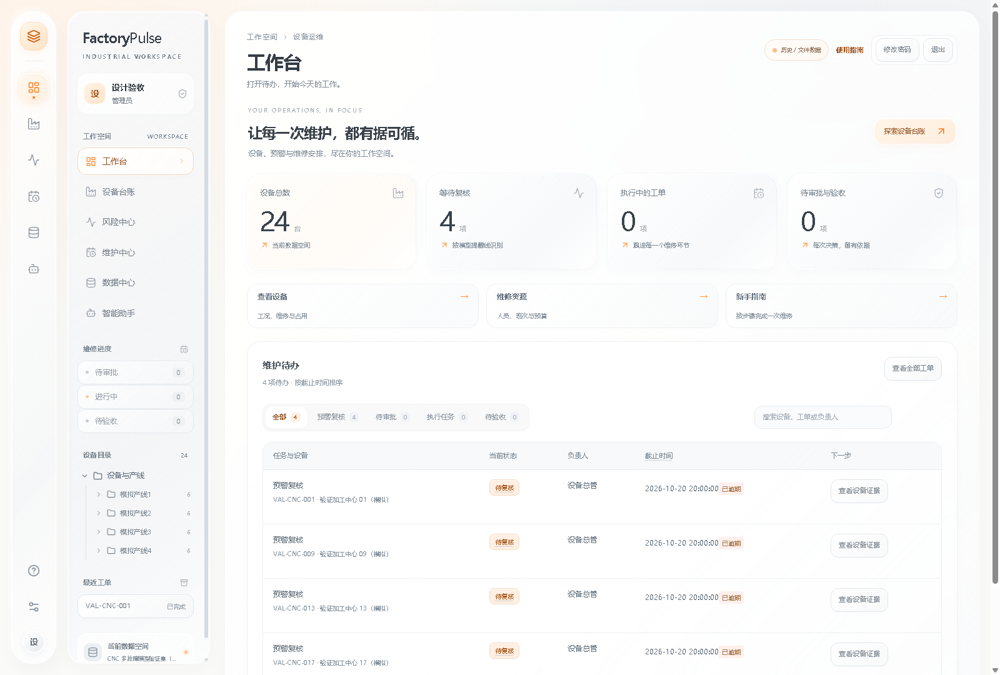

# FactoryPulse

**设备风险证据、维护排程与工单协作工作台。**

FactoryPulse 是面向设备管理人员的维护辅助决策系统：从监测数据中定位需要复核的设备，在人员、班次、库存和生产占用约束下生成维护安排，再由人员审批、执行与验收。

> 当前版本用于工程验证与业务流程演练。最终软件验收使用冻结的合成机床数据；尚未证明真实工厂中的预测准确率、停机改善或经济收益。



## 主要功能

| 模块 | 能力 |
| --- | --- |
| 工作台 | 设备概况、预警复核、审批与验收待办、工单状态跟进 |
| 设备台账 | 监测趋势、异常证据、历史维修、设备占用与数据来源 |
| 风险中心 | 模型评分、趋势与规则参考、SHAP 解释、评估指标与提醒负担 |
| 维护中心 | 维修需求、三方案比较、资源约束排程、审批、接单、开工、完工、验收和返修 |
| 数据中心 | CSV/XLSX、SQLite / 兼容 SQL 文件导入、字段映射、实际数据质量检查、数据版本与来源追溯 |
| 智能助手 | 设备证据查询与维修需求草拟；正式操作仍须授权人员确认 |
| 个人中心 | 账号信息、角色待办、工单查询、修改密码、退出，以及管理员创建账号 |
| 系统管理 | 独立账号、角色权限、操作审计、备份恢复与 AI 服务配置 |

界面采用暖白色液态玻璃风格、橙色强调和双层导航，适配桌面与手机。首次登录会进入五步新手教程；进度按账号保存，完成后不再自动出现。

## AI Agent Harness

助手支持任务与成功标准、会话恢复、短期上下文/会话/长期记忆、工具勾选、版本绑定的一次性授权、数据库事务与审计、超时重试及阶段性时间预算。设备名称、人员班次、订单时间表和情景参数的变更须在界面逐次授权。完整配置、JSON Schema、API 示例、工业流程技能与验证边界见 [Agent Harness 教程](docs/AGENT-HARNESS.md)。

## 快速开始

推荐环境：**Windows、64 位 Python 3.12、Node.js 22+、pnpm 11.25.0**。后端依赖锁面向 Windows / Python 3.12，其他平台需另行验证。

```powershell
git clone https://github.com/Observl/FactoryPulse.git
cd FactoryPulse
py -3.12 -m venv .venv
.venv\Scripts\python.exe -m pip install -r backend/requirements.lock.txt
corepack pnpm install --frozen-lockfile
npm run build
powershell -NoProfile -ExecutionPolicy Bypass -File scripts/start-local.ps1
```

打开 **http://127.0.0.1:8000**。如未启用 Corepack，可先安装 pnpm 11.25.0，再运行 `pnpm install --frozen-lockfile`。

1. 配置服务端 Cloudflare D1 账号中心机密文件（见下方部署说明），使用已有账号登录；账号、密码、角色和会话统一读取 D1。
2. 完成新手教程，进入工作台。首次空库会载入冻结的模型验证集。
3. 点击左侧头像进入**个人中心**。管理员可展开“创建与管理账号”，为其他人员创建独立账号并分配角色。
4. 按“复核 → 需求 → 排程 → 审批 → 执行 → 验收”体验维护闭环。

正式启动脚本默认将业务数据保存在 `%LOCALAPPDATA%\FactoryPulse\data`。可通过环境变量 `FACTORYPULSE_DATA_DIR` 指定其他目录。账号及会话保存在 Cloudflare D1；业务数据库、备份和账号中心凭据不随源码发布。

### 角色与个人待办

- **开发者**：账号管理、系统配置与维护业务操作，人员编号为 0。
- **管理员**：预警复核、需求排程、审批和验收，人员编号为 -1。管理待办目前是角色共享队列，尚未指定个人负责人。
- **普通用户**：账号关联正整数人员编号后，仅在个人待办中显示分配给自己的可执行工单。
- **只读用户**：查询业务数据和自己的账号信息，没有业务处理权限。

每个人均可修改自己的密码、退出登录。修改密码会使旧会话失效，需要重新登录。创建新账号仅限开发者。

### 开发运行

在两个终端分别执行：

```powershell
.venv\Scripts\python.exe -m uvicorn backend.main:app --host 127.0.0.1 --port 8000
```

```powershell
npm run web
```

前端地址为 http://127.0.0.1:5173，开发服务器将 `/api` 转发到后端。开发模式同样需要登录。

## 唯一最终软件验收集

| 项目 | 内容 |
| --- | --- |
| 文件 | `data/model-validation/dataset.json` |
| 身份 | `model-validation-v1-4141a127f218` |
| 来源 | `SYNTHETIC_CNC_MODEL_VALIDATION_V1` |
| 规模 | 24 台合成机床、34,560 条监测记录、144 次合成故障 |
| SHA-256 | `4141a127f218e19c11e3231e8f5c1910fb13426d9b14623fb645c89a9861a947` |

监测值和故障标签已冻结，载入时会核验摘要。仅明确标识的模拟班次、订单与停机窗口随演练日期调整。旧原始实验集与重复数据包已移除；小型单元测试夹具不作为最终验收数据。企业文件可以单独导入，但导入成功不代表模型已适用于该企业。

## 验证与测试

```powershell
.venv\Scripts\python.exe -m pip install -r backend/requirements-test.lock.txt
.venv\Scripts\python.exe -m pytest -q -p no:cacheprovider
npm run test:client
node scripts/test-operational-tasks.mjs
npm run build
.venv\Scripts\python.exe scripts/final-acceptance.py
```

最终验收脚本在隔离数据库中使用上述冻结数据，检查模型证据、数据质量、只读预览、方案持久化、联合排程及完整工单生命周期。生成报告位于 `outputs/final-acceptance/report.json`，运行产物不提交到 Git。

浏览器界面验证和账号权限测试均已开展；自动检查不能替代真实人员试用、完整跨浏览器验收或现场效果评估。

## 模型与优化的适用边界

- 设备排序有模型时直接使用模型分数；无模型时，单独标识趋势或规则参考，不能继承模型的验证成绩。
- 分数未经概率校准，不作为经济收益公式中的故障概率。展示用分段不等于经过验证的提醒阈值。
- 模型和阈值依据验证集选择；数据允许时另保留隔离 168 小时的后段稳定性评估，不参与选择。提醒容量限制仍需实际管理人员校准。
- 评估区分窗口指标、独立故障事件、首次命中提前量与合并提醒负担。首次命中不等于稳定预警，提醒次数也不等于现场出勤次数。
- 三方案比较使用相同人员、技能、班次、生产占用、库存、预算与工时条件；批准和开工仍重新检查。优化目标为维护优先级总分，不承诺企业综合经济收益最优。
- 编号顺序属于弱基线，不能代表工厂现行维修策略。合成数据上的成绩不能证明跨设备、跨工厂泛化。

仍需外部验证的内容包括：真实设备管理人员试用、五分钟操作目标、真实设备预测效果、停机与经济收益、干净 Windows 安装和物理断网验收。

## 技术结构

```text
src/                    React + TypeScript 界面与业务交互
backend/                FastAPI、SQLite、模型分析与维护排程
config/                 模型训练与助手配置
data/model-validation/ 唯一冻结的软件验收数据
scripts/                启动、测试、最终验收与离线交付工具
tests/                  后端回归测试
docs/                   操作、设计、模型边界与验收说明
```

技术栈：React 18、Vite、TypeScript、Recharts、FastAPI、SQLite、XGBoost / SHAP、OR-Tools CP-SAT；Electron 提供桌面外壳。

## 文档

- [完整云端部署与 Cloudflare D1 账号中心](docs/CLOUD-DEPLOYMENT.md)

- [完整决策计划思维导图](docs/DECISION-MAP.md)
- [统一按钮组件模板与布局约束](docs/BUTTON-COMPONENTS.md)
- [评分计算说明与排程约束](docs/SCORING-AND-SCHEDULING.md)
- [操作指南](docs/OPERATOR-GUIDE.md)
- [登录与新手教程](docs/LOGIN-ONBOARDING.md)
- [SQL 数据库导入与设备状态](docs/SQL-DATABASE-IMPORT.md)
- [本地部署与离线交付](docs/LOCAL-DEPLOYMENT.md)
- [冻结验证集说明](docs/MODEL-VALIDATION-DATASET.md)
- [问题修复与验收边界](docs/FINAL-REVIEW-REMEDIATION.md)
- [界面设计规范](DESIGN.md)

## 许可证

[MIT](LICENSE)

## 统一完整应用与账号中心

所有环境运行同一套完整 React 工作台和 Python API，不再提供精简展示页、前端模拟登录或按域名隐藏功能。账号使用从 10001 递增的 `user_id` 登录，D1 不再保存 `username`。四类角色、人员编号与密码格式见 [账号表规则](docs/ACCOUNT-SCHEMA.md)。只有显式指定的只读访客账号提供一键入口。

服务端必须配置 `FACTORYPULSE_IDENTITY_CONFIG` 指向私有 D1 配置文件，或使用项目 `.secrets/identity.json`。正常启动未配置时直接拒绝启动，不回退到本机账号。令牌只存在服务端机密文件，不能进入仓库或浏览器。

GitHub Pages 发布相同的完整前端；它无法运行 Python、模型计算和业务数据库。完整可运行部署使用仓库 Docker/Caddy 方案，在服务器上同时运行界面和 API。尚未提供服务器时，Pages 单独无法完成登录和业务处理，D1 不能替代业务服务。配置与启动方法见 [完整服务部署](docs/CLOUD-DEPLOYMENT.md)。
