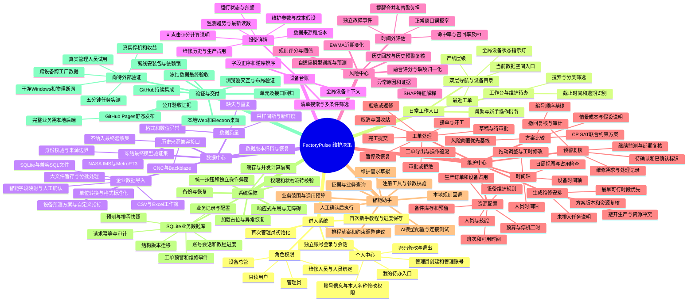
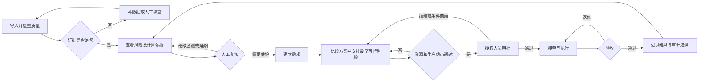

# FactoryPulse 决策计划与完整模块图

以当前源码为准（2026-10-22）。主线为：可信数据 → 风险证据 → 人员复核 → 维护需求 → 资源排程 → 审批执行 → 验收追溯。评分是检查优先级，未经概率校准；合成验收不等于现场效果。

## 决策闭环

## 模块核对依据

- 页面与交互：`src/App.tsx`、`src/WorkspaceNavigation.tsx` 和各页面组件。
- API与业务：`backend/main.py`、`security.py`、`resources.py`、`execution.py`、`inventory.py`。
- 导入与版本：`import_pipeline.py`、`database_import.py`、`smart_import.py`、`field_profiles.py`。
- 算法与解释：`analytics.py`、`adaptive_training.py`、`score_explanation.py`、`replay.py`。
- 助手：`agent*.py`；交付与验证：`scripts/`、`tests/`、`.github/workflows/`。

数据库文件清单另由 `scripts/list-databases.py` 按实际磁盘生成；数据库副本不代表独立的业务系统。SQL导入指兼容文件解析，不代表已支持远程MySQL或PostgreSQL直连。
